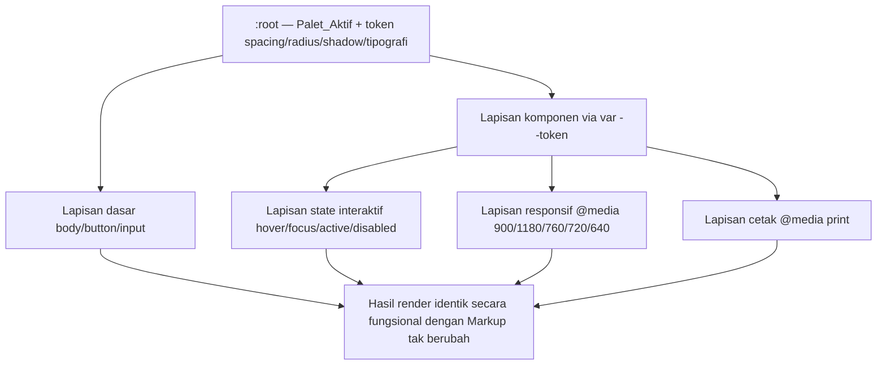

# Design Document

## Overview

Fitur `ui-visual-refresh` adalah **refactor CSS murni presentasional** pada aplikasi inventory/POS Ifal Store. Seluruh pekerjaan terbatas pada satu berkas, yaitu `crud/src/App.css` (selanjutnya disebut *Stylesheet*). Tujuannya memberi tampilan modern SaaS yang bersih dan konsisten melalui konsolidasi token desain, penyeragaman tipografi/spacing, perapihan komponen inti, penegasan state interaktif, dan pemenuhan kontras WCAG — **tanpa mengubah perilaku, layout fungsional, maupun markup**.

Pendekatan inti:

- **Tidak menyentuh JSX.** Berkas `crud/src/App.jsx` dan `crud/src/FeatureViews.jsx` (selanjutnya *Markup*) tetap identik byte-per-byte. Semua hasil visual dicapai hanya dengan memilih ulang nilai pada selektor atas kelas dan elemen yang sudah ada (*Kelas_Kontrak*). (Requirement 1)
- **Tanpa dependency baru.** Tidak ada Tailwind, framework CSS, atau `@import` baru selain aset font Google Fonts (DM Sans, Manrope) yang sudah dirujuk. (Requirement 1.5, 3.2, 3.3)
- **Satu sumber kebenaran untuk palet.** Dua blok `:root` yang ada saat ini dikonsolidasikan menjadi satu palet efektif (*Palet_Aktif*) yang di-resolve konsisten. (Requirement 2)
- **Presentasional, bukan fungsional.** Visibilitas, klikabilitas, urutan penumpukan (z-index), dan hasil DOM yang teramati tetap identik. (Requirement 9)

Konteks faktual Stylesheet saat ini (hasil investigasi, ~443 baris, satu baris CSS dapat memuat banyak aturan):

- Terdapat **dua blok `:root`**. Blok pertama (atas) mendefinisikan palet biru (`--navy: #253d7c`, `--blue: #3567d6`, dst). Blok kedua (bawah) meng-*override* menjadi palet teal/hijau (`--ink: #172b3a`, `--muted: #718392`, `--line: #e4eceb`, `--paper: #fff`, `--wash: #f3f7f6`, `--navy: #173f43`, `--blue: #168276`, `--green: #208569`, `--orange: #bd792c`, `--red: #bd5960`). Karena kaskade, *Palet_Aktif* saat ini adalah teal/hijau.
- Banyak aturan pada bagian bawah berkas menggunakan **nilai hex literal** untuk peran yang sebenarnya sudah memiliki token (mis. `#17363a`, `#176e68`, `#245a58`, `#64ad9e`, `#e0e9e7`), menjadi sumber inkonsistensi.
- `.feature-launcher` **didefinisikan tiga kali** (duplikasi/override berurutan), dengan versi terakhir yang menjadi efektif.
- Breakpoint yang benar-benar ada: **900px, 1180px, 760px, 720px, 640px**. Terdapat `@media print` untuk `.invoice-print` dan `.feature-overlay.report-print` serta aturan `.no-print`. Terdapat pula `@media (prefers-reduced-motion: reduce)` dan `:focus-visible` global yang sudah ada.

## Architecture

### Strategi styling

Stylesheet tetap berupa satu berkas CSS global tanpa pipeline tambahan. Arsitektur presentasional disusun berlapis dari atas ke bawah berkas sesuai urutan kaskade:

1. **Lapisan token (`:root`)** — sumber kebenaran untuk warna, spacing, radius, shadow, dan peran tipografi.
2. **Lapisan dasar** — reset ringan, elemen dasar (`body`, `button`, `input`, `select`, `textarea`), dan tipografi dasar.
3. **Lapisan komponen** — aturan atas *Kelas_Kontrak* (sidebar, topbar, kartu, tabel, modal, tombol, badge, toast, notif, login, feature launcher/overlay, invoice).
4. **Lapisan state interaktif** — hover, focus-visible, active, disabled, dan selected (`.active`).
5. **Lapisan responsif** — blok `@media (max-width: ...)` pada 900/1180/760/720/640.
6. **Lapisan cetak** — blok `@media print`.

### Strategi token: konsolidasi dua blok `:root`

Masalah: ada dua blok `:root`. Menghapus blok pertama berisiko karena beberapa aturan di bagian atas berkas membaca token melalui `var(--token)` (mis. `var(--blue)`, `var(--navy)`, `var(--line)`) dan mengharapkan nilai tertentu saat dirender.

Keputusan desain: **pertahankan nama token yang sudah ada** supaya setiap `var(--token)` lama tetap valid, dan jadikan **blok `:root` final** sebagai satu-satunya pendefinisi nilai efektif. Karena kaskade CSS, deklarasi `:root` terakhir menang; desain memastikan *Palet_Aktif* ter-resolve ke tepat satu nilai per token (Requirement 2.1, 2.2). Konsolidasi dilakukan dengan dua opsi yang keduanya memenuhi kontrak:

- **Opsi A (direkomendasikan):** gabungkan kedua deklarasi menjadi satu blok `:root` tunggal berisi palet teal/hijau final + token baru (spacing/radius/shadow/tipografi). Ini menghilangkan ambiguitas dan duplikasi.
- **Opsi B (fallback aman):** biarkan dua blok tetapi pastikan blok terakhir mendeklarasikan **semua** token warna sehingga nilai akhir deterministik; tambahkan token baru di blok terakhir.

Catatan penting: **menambahkan custom property baru di `:root` TIDAK melanggar batasan** fitur ini. Custom property adalah aturan styling di dalam `crud/src/App.css`, bukan perubahan Markup dan bukan dependency eksternal. (Requirement 1.3, 1.5)

### Strategi mengganti literal menjadi `var(--token)`

Untuk setiap peran warna yang memiliki token (teks `--ink`/`--muted`, garis `--line`, latar `--paper`/`--wash`, aksen `--navy`/`--blue`/`--green`/`--orange`/`--red`):

- Ganti nilai hex/rgb/hsl literal pada aturan *Kelas_Kontrak* dengan `var(--token)` yang sesuai perannya. (Requirement 2.3, 2.4)
- Untuk warna turunan (mis. hover yang lebih gelap, latar lembut badge) yang belum punya token, sediakan **token turunan** baru di `:root` (mis. `--blue-strong`, `--surface-soft-blue`) agar tetap satu sumber kebenaran, atau gunakan fungsi warna relatif hanya bila didukung aman. Nilai literal murni warna dekoratif yang tidak punya peran token (mis. bayangan rgba transparan) boleh tetap sebagai nilai, karena bukan "peran yang memiliki Token_Desain".
- Sediakan **fallback** pada pemanggilan kritikal, mis. `var(--ink, #172b3a)`, agar bila suatu token tak terdefinisi komponen tetap tampil dengan warna fallback dan layout utuh. (Requirement 4.8)

### Diagram alur kaskade token

## Components and Interfaces

"Interface" di sini adalah **kontrak kelas CSS**: nama kelas/elemen yang dirujuk Markup. Desain hanya memilih ulang nilai pada selektor yang sudah ada. Pemetaan komponen → aturan:

### Sidebar, topbar, welcome row (Requirement 4.1, 2.5)
- Sidebar mempertahankan tema gelap teal (`background` dari token navy-gelap). Warna teks nav, state hover/active dirujuk via token. Spacing (padding item, gap) memakai skala spacing.
- Topbar + welcome row terang: judul `Manrope` (peran "heading"), subteks `--muted`. Breadcrumb, sync-status, pulse memakai token status.
- Elemen sejenis di ketiga area menggunakan nilai warna & langkah spacing identik.

### Kartu statistik `.stats-grid` / `.stat-card` (Requirement 4.2)
- Setiap `.stat-card` memakai nilai identik untuk border-width, border-radius, dan box-shadow (dari token `--radius-*` dan `--shadow-*`).
- Ikon status (`.stat-icon.blue/green/orange/red`) memetakan ke token peran warna + latar lembutnya.

### Panel katalog + tabel `.catalog-panel`, `table`, `th`, `td` (Requirement 4.3)
- `.catalog-panel` memakai radius/shadow dari token yang sama dengan kartu.
- Semua `td` dalam satu tabel memakai padding identik (satu langkah spacing); garis pemisah baris (`border-top` pada `td`) memakai `var(--line)` dengan ketebalan identik.
- `th` memakai latar wash + teks muted.

### Modal `.modal` / `.modal-backdrop` (Requirement 4.4, 9.3)
- `.modal` memakai radius & shadow dari token. `.modal-backdrop` tetap `position: fixed; inset: 0` dengan `z-index` di bawah modal dan di atas konten biasa. Urutan penumpukan tidak diubah.

### Tombol `.primary-button`, `.secondary-button`, `.danger-button` (Requirement 4.5)
- Tiga tombol memiliki latar yang **saling berbeda**: primary = aksen utama (navy/teal), secondary = netral (paper + border line), danger = `--red`. Semua dirujuk via token.

### Badge `.status`, `.role-badge`, `.purchase-status` (Requirement 4.6, 6.4)
- Tiap nilai status berbeda memiliki warna latar/teks berbeda (mis. `.active` hijau, `.low-stock` oranye, `.out-of-stock` merah; `.role-badge.admin` vs `.staff`; `.purchase-status.*`).
- Pembeda non-warna yang sudah ada di Markup (titik `.status span`, label teks, kapsul bentuk) dipertahankan agar status tidak hanya dibedakan oleh warna.

### Toast, notif-panel, login, feature-launcher/overlay (Requirement 4.7)
- `.toast` (success/error), `.notif-panel`, `.login-card`, `.feature-launcher`, `.feature-overlay` memakai warna *Palet_Aktif* dan langkah spacing yang sama untuk elemen sejenis.

### Feature launcher: konsolidasi duplikasi (Requirement 1.3, 9.4)
- `.feature-launcher` terdefinisi tiga kali. Desain menggabungkan menjadi **satu definisi efektif** yang memberi hasil akhir identik dengan definisi terakhir yang berlaku sekarang (varian fixed bar di kanan-bawah dengan `.feature-launcher-bar`, `.feature-menu-toggle`, `.feature-menu-items`, `.feature-warehouse`), lalu merapikan aturan responsifnya tanpa mengubah posisi/perilaku akhir.

## Data Models

Fitur ini tidak memiliki model data runtime. "Model data"-nya adalah **kumpulan Token_Desain** sebagai custom properties di `:root`.

### Token warna final (nama dipertahankan agar `var()` lama tetap valid)

| Token | Nilai final (teal/hijau) | Peran |
|---|---|---|
| `--ink` | `#172b3a` | Teks utama |
| `--muted` | `#718392` | Teks sekunder |
| `--line` | `#e4eceb` | Garis/border |
| `--paper` | `#ffffff` | Latar permukaan |
| `--wash` | `#f3f7f6` | Latar halaman |
| `--navy` | `#173f43` | Aksen gelap (sidebar, heading) |
| `--blue` | `#168276` | Aksen utama/interaktif |
| `--green` | `#208569` | Status sukses/aktif |
| `--orange` | `#bd792c` | Status peringatan |
| `--red` | `#bd5960` | Status bahaya/error |

Token turunan (opsional, untuk menghapus literal hover/surface): `--blue-strong`, `--navy-strong`, `--surface-soft`, `--sidebar-bg`, `--sidebar-ink`. Semua didefinisikan di `:root`.

### Token spacing (skala tunggal eksplisit — Requirement 3.4)

| Token | Nilai | Pemakaian khas |
|---|---|---|
| `--space-1` | `4px` | gap kecil, padding ikon |
| `--space-2` | `8px` | gap kontrol |
| `--space-3` | `12px` | padding tombol vertikal |
| `--space-4` | `16px` | gap grid, padding kartu |
| `--space-5` | `22px` | padding panel/tabel |
| `--space-6` | `32px` | margin seksi |

### Token radius & shadow (Requirement 4.2, 4.4)

| Token | Nilai | Pemakaian |
|---|---|---|
| `--radius-sm` | `8px` | input, badge, tombol kecil |
| `--radius-md` | `9px` | tombol, nav-item |
| `--radius-lg` | `13px` | kartu, panel |
| `--radius-xl` | `15px` | modal |
| `--shadow-card` | `0 5px 18px rgba(34,69,70,.035)` | kartu/panel |
| `--shadow-pop` | `0 24px 70px rgba(20,45,48,.22)` | modal/popover |

### Peran tipografi (Requirement 3.1, 3.2)

| Peran | Font | Ukuran/Bobot/Line-height |
|---|---|---|
| Heading besar | Manrope | `800 clamp(24px,2vw,30px) / 1.2` |
| Heading panel | Manrope | `700 16px / 1.3` |
| Teks tubuh | DM Sans | `400 13px / 1.5` |
| Label/metadata | DM Sans | `600 11px / 1.4` |
| Eyebrow | DM Sans | `700 10px / 1.4`, uppercase |

Bobot terbatas pada aset yang dirujuk: DM Sans 400/500/600/700; Manrope 600/700/800. Tidak ada keluarga font lain sebagai font utama. (Requirement 3.2, 3.3)

### Pertimbangan kontras (Requirement 6)

Pasangan teks/latar dipilih agar memenuhi WCAG 2.1:
- Teks `--ink (#172b3a)` di atas `--paper (#fff)` dan `--wash (#f3f7f6)` → rasio jauh di atas 4.5:1.
- Teks `--muted (#718392)` di atas `--paper` → diperiksa ≥ 4.5:1; bila suatu konteks turun di bawah ambang, nilai dipertahankan/diperkuat, bukan diturunkan. (Requirement 6.5)
- Teks terang sidebar di atas latar teal gelap → ≥ 4.5:1.
- Teks badge (hijau/oranye/merah) di atas latar lembutnya → diperiksa ≥ 4.5:1 untuk teks normal.
- Indikator focus-visible kontras ≥ 3:1 terhadap latar yang berdekatan. (Requirement 6.3)

## Correctness Properties

*Sebuah properti adalah karakteristik atau perilaku yang harus selalu benar di seluruh eksekusi valid sebuah sistem — pada dasarnya pernyataan formal tentang apa yang harus dilakukan sistem. Properti menjadi jembatan antara spesifikasi yang terbaca manusia dan jaminan kebenaran yang dapat diverifikasi mesin.*

Fitur ini adalah perubahan CSS presentasional, bukan fungsi murni dengan input/output. Sebagian besar kriteria tergolong pemeriksaan statis atas Stylesheet/Markup atau verifikasi visual, bukan property-based testing bergaya "for all input acak". Meskipun demikian, beberapa invarian dapat dinyatakan sebagai properti yang dikuantifikasi universal atas himpunan berhingga (aturan CSS, kelas, token, breakpoint) dan diperiksa secara otomatis melalui analisis teks Stylesheet dan diff Markup.

### Property 1: Markup tidak berubah
*Untuk semua* berkas dalam `{crud/src/App.jsx, crud/src/FeatureViews.jsx}`, isi byte setelah refresh sama persis dengan isi byte sebelum refresh.
**Validates: Requirements 1.1, 1.2, 1.4, 9.4**

### Property 2: Hanya Stylesheet yang dimodifikasi
*Untuk semua* berkas yang berubah dalam diff fitur ini, berkas tersebut adalah `crud/src/App.css`.
**Validates: Requirements 1.1, 1.6**

### Property 3: Setiap selektor merujuk kelas/elemen yang ada di Markup
*Untuk semua* selektor kelas pada Stylesheet, nama kelas tersebut muncul pada *Kelas_Kontrak* (dirujuk oleh Markup).
**Validates: Requirements 1.3, 1.4**

### Property 4: Tanpa dependency styling eksternal baru
*Untuk semua* pernyataan `@import`/`url(...)` pemuatan styling pada Stylesheet, sumbernya adalah aset font DM Sans/Manrope yang sudah dipakai sebelumnya.
**Validates: Requirements 1.5, 3.2, 3.3**

### Property 5: Peran berwarna dirujuk via token
*Untuk semua* deklarasi warna pada *Kelas_Kontrak* yang perannya memiliki Token_Desain, nilainya berupa `var(--token)` dan bukan literal hex/rgb/hsl.
**Validates: Requirements 2.3, 2.4**

### Property 6: Palet_Aktif deterministik satu nilai per token
*Untuk setiap* Token_Desain warna, setelah seluruh blok `:root` dievaluasi, nilai efektifnya tepat satu (sesuai deklarasi `:root` terakhir dalam kaskade).
**Validates: Requirements 2.1, 2.2, 2.5**

### Property 7: Fallback token mempertahankan tampilan
*Untuk setiap* pemanggilan token kritikal pada komponen, bila token tidak terdefinisi maka warna fallback yang ditetapkan berlaku dan tata letak komponen tetap utuh (tanpa elemen hilang/tumpang tindih).
**Validates: Requirements 4.8**

### Property 8: Keseragaman peran teks
*Untuk setiap* pasang elemen dengan peran teks yang sama, keduanya memiliki nilai font-family, font-size, font-weight, dan line-height yang identik.
**Validates: Requirements 3.1**

### Property 9: Keseragaman langkah spacing komponen setara
*Untuk setiap* pasang komponen setara, padding dan margin dengan peran sama berasal dari langkah spacing yang sama.
**Validates: Requirements 3.4, 4.1, 4.7**

### Property 10: Kartu statistik konsisten
*Untuk semua* `.stat-card`, nilai border-width, border-radius, dan box-shadow identik satu sama lain.
**Validates: Requirements 4.2**

### Property 11: Padding sel tabel dan garis pemisah konsisten
*Untuk semua* `td` dalam satu tabel, nilai padding identik, dan setiap pemisah baris memiliki ketebalan serta warna garis yang identik.
**Validates: Requirements 4.3**

### Property 12: Tiga tombol memiliki latar berbeda
*Untuk* `.primary-button`, `.secondary-button`, dan `.danger-button`, ketiganya memiliki warna latar yang saling berbeda.
**Validates: Requirements 4.5**

### Property 13: Nilai status pada satu badge saling berbeda warna
*Untuk setiap* badge pada `{.status, .role-badge, .purchase-status}` dan setiap pasang nilai status berbeda di dalamnya, warna latar atau warna teksnya berbeda.
**Validates: Requirements 4.6**

### Property 14: Status punya pembeda non-warna
*Untuk setiap* status yang disampaikan lewat warna, terdapat minimal satu pembeda non-warna (ikon, label teks, atau bentuk) yang sudah ada di Markup.
**Validates: Requirements 6.4**

### Property 15: Hover memberi perubahan teramati
*Untuk setiap* tombol atau item navigasi yang tidak disabled, gaya hover berbeda dari default pada minimal satu properti (latar/teks/border/bayangan).
**Validates: Requirements 5.1**

### Property 16: Indikator focus-visible memadai
*Untuk setiap* elemen interaktif yang menerima fokus keyboard, muncul outline/ring focus-visible dengan ketebalan ≥ 2px yang berbeda warna dari latar elemen, dan kontras ≥ 3:1 terhadap latar berdekatan.
**Validates: Requirements 5.2, 6.3**

### Property 17: State pressed berbeda dari hover dan default
*Untuk setiap* tombol/item navigasi tidak disabled saat active/pressed, gaya pressed berbeda dari hover maupun default pada minimal satu properti teramati.
**Validates: Requirements 5.3**

### Property 18: State disabled berbeda dan menonaktifkan hover
*Untuk setiap* tombol disabled, gayanya berbeda dari keadaan aktif pada minimal satu properti (opasitas/latar/teks) dan perubahan hover dinonaktifkan.
**Validates: Requirements 5.4**

### Property 19: Item navigasi aktif berbeda dari non-aktif
*Untuk setiap* item navigasi `active`, gayanya berbeda dari item non-aktif pada minimal satu properti teramati (latar/teks/aksen border).
**Validates: Requirements 5.5**

### Property 20: Kontras teks memenuhi ambang WCAG
*Untuk setiap* komponen *Kelas_Kontrak*, rasio kontras teks terhadap latar efektifnya ≥ 4.5:1 untuk teks normal dan ≥ 3:1 untuk teks besar, dan tidak ada perubahan yang menurunkannya di bawah ambang.
**Validates: Requirements 6.1, 6.2, 6.5**

### Property 21: Semua breakpoint dipertahankan
*Untuk setiap* Breakpoint yang sudah ada (900px, 1180px, 760px, 720px, 640px), aturan responsifnya tetap ada dan tidak dinonaktifkan.
**Validates: Requirements 7.1**

### Property 22: Grid statistik satu kolom pada ≤ 640px
*Saat* lebar viewport ≤ 640px, grid statistik tersusun satu kolom per baris, dan sidebar/toolbar/tabel tidak melebihi lebar viewport maupun saling tumpang tindih.
**Validates: Requirements 7.2, 7.3**

### Property 23: Overflow tabel horizontal, bukan halaman
*Untuk setiap* tabel yang lebih lebar dari kontainernya, kontainer mengaktifkan guliran horizontal sehingga semua kolom dapat diakses; pada rentang viewport 320px–1920px tidak terjadi guliran horizontal di tingkat halaman.
**Validates: Requirements 7.4, 7.5**

### Property 24: Print menampilkan hanya target cetak
*Saat* mencetak invoice, hanya `.invoice-print` dan turunannya terlihat; *saat* mencetak laporan, hanya `.feature-overlay.report-print` dan turunannya terlihat; elemen `.no-print` selalu disembunyikan; selektor di dalam `@media print` tidak dihapus/diubah.
**Validates: Requirements 8.1, 8.2, 8.3, 8.4**

### Property 25: Urutan penumpukan dipertahankan
*Untuk* lapisan UI, urutan z-index dipertahankan: toast ≥ modal > backdrop > feature overlay dan notif panel > konten dasar.
**Validates: Requirements 9.3**

### Property 26: Elemen interaktif tetap terlihat dan dapat diklik
*Untuk setiap* elemen interaktif yang sebelumnya terlihat, setelah refresh ia tetap terlihat (visibility bukan hidden, display bukan none, opacity > 0) dan dapat diklik (pointer-events bukan none, tidak tertutup), kecuali pengecualian `.sr-only`, responsif < 768px, dan Print_Styles.
**Validates: Requirements 9.1, 9.2, 9.5**

## Error Handling

Karena ini styling statis, "error" berarti pelanggaran kontrak presentasional. Penanganan:

- **Token hilang/typo:** gunakan fallback `var(--token, <nilai-aman>)` pada pemanggilan kritikal agar komponen tetap tampil (Property 7, Requirement 4.8).
- **Selektor menyentuh kelas yang tak ada di Markup:** dilarang; setiap aturan diverifikasi merujuk *Kelas_Kontrak* (Property 3).
- **Perubahan di luar `App.css` atau dependency baru:** ditolak dan dikembalikan ke kondisi sebelumnya (Requirement 1.6, Property 2, 4).
- **Regresi visibilitas/klikabilitas:** bila suatu elemen interaktif menjadi tersembunyi/tak dapat diklik di luar pengecualian, perubahan dianggap regresi dan dibatalkan (Requirement 9.5, Property 26).
- **Penurunan kontras:** bila sebuah perubahan warna akan menurunkan kontras di bawah ambang, perubahan tidak diterapkan dan nilai lama yang memenuhi ambang dipertahankan (Requirement 6.5, Property 20).
- **Degradasi font:** bila aset font gagal dimuat, stack fallback sistem (mis. `sans-serif`/`Segoe UI`) menjaga keterbacaan tanpa mengubah layout.

## Testing Strategy

Fitur ini adalah CSS presentasional murni, sehingga **property-based testing bergaya input acak tidak sesuai**. Strategi menitikberatkan verifikasi build, lint, pemeriksaan statis Stylesheet/Markup, dan verifikasi visual/manual lintas komponen dan breakpoint. Properti korektikas di atas diperiksa sebagai invarian statis (analisis teks CSS + diff Markup) dan pemeriksaan visual, bukan melalui pustaka PBT.

### Verifikasi build & lint (otomatis)
- **Build Vite:** jalankan `npm run build` di folder `crud` — harus sukses tanpa error. (mendukung Property 1–6)
- **Lint:** jalankan `npm run lint` (oxlint) — harus tetap lolos. Karena perubahan hanya pada CSS, lint JS tidak boleh menghasilkan error baru.
- Catatan: gunakan eksekusi sekali jalan (bukan mode watch). Hindari menjalankan `npm run dev` dalam pipeline verifikasi.

### Pemeriksaan non-regresi statis (otomatis)
- **Diff Markup:** pastikan `git diff` tidak menyentuh `crud/src/App.jsx` dan `crud/src/FeatureViews.jsx` (byte-identik). (Property 1)
- **Scope diff:** pastikan satu-satunya berkas berubah adalah `crud/src/App.css`. (Property 2)
- **Kelas valid:** ekstrak nama kelas dari selektor Stylesheet dan pastikan setiap kelas muncul di Markup. (Property 3)
- **Tanpa import baru:** grep `@import`/`url(` untuk memastikan hanya aset font DM Sans/Manrope. (Property 4)
- **Literal warna:** grep nilai hex/rgb/hsl pada aturan *Kelas_Kontrak* untuk memastikan peran bertoken memakai `var(--token)`. (Property 5)
- **`:root` deterministik:** verifikasi setiap token warna punya nilai akhir tunggal. (Property 6)

### Verifikasi visual/manual per komponen
Checklist render pada login, dashboard (sidebar, topbar/welcome, stat cards, catalog panel + table, footer paginasi), modal (tambah/edit, import, invoice), toast (success/error), notif-panel, profile, dan feature overlay (expense, POS, cash session, backup, report). Untuk tiap komponen periksa: warna sesuai token, spacing seragam, radius/shadow konsisten, badge status terbaca. (Property 8–14)

### Verifikasi state interaktif (manual)
Untuk tombol dan nav-item: hover berubah, focus-visible terlihat (≥ 2px, kontras cukup), pressed berbeda, disabled meredup dan hover mati, nav aktif menonjol. Verifikasi `@media (prefers-reduced-motion: reduce)` yang sudah ada tetap aktif. (Property 15–19)

### Verifikasi responsif (manual)
Uji pada lebar 320px, 640px, 720px, 760px, 900px, 1180px, dan 1920px: grid statistik satu kolom pada ≤ 640px, tidak ada horizontal scroll halaman, tabel menggulir horizontal bila perlu, sidebar/toolbar tidak tumpang tindih. (Property 21–23)

### Verifikasi cetak (manual)
Cetak invoice → hanya `.invoice-print` tampil; cetak laporan → hanya `.feature-overlay.report-print` tampil; elemen `.no-print` tersembunyi. (Property 24)

### Verifikasi kontras (manual/alat)
Gunakan alat pemeriksa kontras (mis. DevTools) untuk pasangan teks/latar utama memenuhi 4.5:1 (normal) / 3:1 (besar) dan focus-visible ≥ 3:1. Catatan: pemenuhan WCAG penuh memerlukan pengujian manual dengan teknologi bantu dan tinjauan ahli aksesibilitas. (Property 16, 20)

### Verifikasi non-regresi fungsional (manual)
Jalankan alur inti sebelum vs sesudah: login/logout, CRUD produk, import, pembuatan purchase, cetak invoice, POS + cash session, notifikasi. Hasil DOM/perilaku yang teramati harus identik. (Property 25, 26)

## Design Decisions and Rationale

1. **Pertahankan nama token yang ada.** Mengganti nama token akan memutus `var(--token)` lama di bagian atas berkas. Mempertahankan nama menjaga kompatibilitas dan memenuhi Requirement 2 tanpa menyentuh Markup.
2. **Tetap di palet teal/hijau (Palet_Aktif saat ini).** Konsisten dengan pilihan pengguna dan meminimalkan risiko kontras; perubahan warna hanya berupa penyempurnaan terkontrol.
3. **Tambah token spacing/radius/shadow/tipografi di `:root`.** Ini legal (bukan dependency, bukan perubahan Markup) dan menjadi fondasi konsistensi (Requirement 3, 4). Trade-off: sedikit penambahan baris CSS, sebanding dengan manfaat konsistensi.
4. **Konsolidasikan dua `:root` dan tiga `.feature-launcher`.** Mengurangi ambiguitas kaskade dan duplikasi. Hasil akhir fungsional/visual dijaga identik dengan definisi efektif saat ini.
5. **Pertahankan `:focus-visible` dan `prefers-reduced-motion` yang sudah ada.** Keduanya mendukung Requirement 5 dan 7; dirapikan, bukan dihapus.
6. **Tidak menulis property-based test.** Domain CSS presentasional tidak memiliki fungsi murni dengan ruang input besar; verifikasi yang tepat adalah build/lint + pemeriksaan statis + visual/kontras/print.

### Catatan risiko & mitigasi

- **Risiko: menghapus blok `:root` pertama** dapat menghilangkan nilai token yang diasumsikan oleh aturan di bagian atas berkas (mis. `var(--blue)` lama). **Mitigasi:** jangan hapus token; konsolidasikan sehingga semua token yang dipakai tetap punya nilai akhir yang valid (Opsi A/B di Architecture).
- **Risiko: mengganti literal menjadi `var()` mengubah warna** bila token tidak mewakili nilai literal lama. **Mitigasi:** petakan literal ke token yang perannya sama; untuk warna turunan (hover/surface) buat token turunan, bukan memaksakan token yang salah peran.
- **Risiko: perubahan spacing menggeser layout** dan memicu horizontal scroll pada breakpoint tertentu. **Mitigasi:** uji pada semua breakpoint (320–1920px) dan verifikasi Requirement 7.
- **Risiko: konsolidasi `.feature-launcher` mengubah posisi fixed bar.** **Mitigasi:** pertahankan geometri dari definisi terakhir yang berlaku dan uji di 900px/640px.
- **Risiko: perubahan z-index memengaruhi overlay/modal/toast.** **Mitigasi:** pertahankan urutan penumpukan sesuai Requirement 9.3 dan verifikasi manual.
